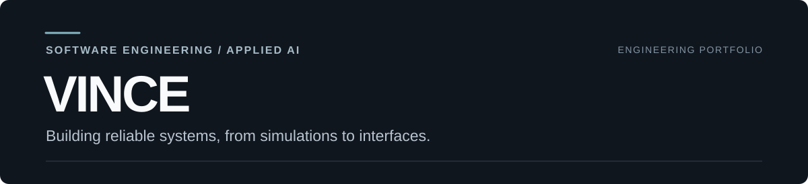

**Software engineering · Computer vision · Data-driven products**

I build tested software, from autonomous-driving simulations to interactive web experiences.

[Selected work](#selected-work) · [CARLA demo](https://github.com/vinceyuchen/Perceptinet#demo-showcase) · [Live website](https://vinceyuchen.github.io/animal-shelter-dv2/) · [Contact](#contact)

## Selected work

### 01 — [Perceptinet](https://github.com/vinceyuchen/Perceptinet)

**Cooperative perception & risk-aware braking | Python · CARLA · YOLO26n**

A CARLA research prototype exploring how onboard and roadside perception, simulated V2I communication, sensor fusion, and TTC-based braking work together when visibility or communication is limited.

*Actual CARLA demo recording · Scenario comparisons use simulated communication faults and kinematic braking, not validated physical collisions.*

**What I built:** dual-camera perception pipeline, simulation-time packet delivery and faults, spatial/temporal fusion, TTC risk logic, real-time dashboards, and event-level metrics.

[**Watch demo**](https://github.com/vinceyuchen/Perceptinet#demo-showcase) · [**Engineering notes**](https://github.com/vinceyuchen/Perceptinet/blob/main/docs/ENGINEERING_NOTES.md) · [**Tests & source**](https://github.com/vinceyuchen/Perceptinet)

---

### 02 — [Behind the Shelter Doors](https://github.com/vinceyuchen/animal-shelter-dv2)

**Interactive data storytelling | JavaScript · Vega-Lite · HTML/CSS**

A published web experience translating Australian animal shelter datasets into 14 interactive visualizations, with clear explanations of sources, comparisons, and reporting boundaries.

*Real browser screenshot of the published site · Open the live website to explore the interactive charts.*

**What I built:** responsive layout, visual storytelling, chart interaction, data normalization, documented design decisions, and automated visualization audits.

[**Explore live site**](https://vinceyuchen.github.io/animal-shelter-dv2/) · [**Design & methodology**](https://github.com/vinceyuchen/animal-shelter-dv2/blob/main/design/visual-design-system.md) · [**Source code**](https://github.com/vinceyuchen/animal-shelter-dv2)

## Technical focus

**Languages:** Python · JavaScript · TypeScript

**Computer vision & systems:** CARLA · YOLO26n · OpenCV · NumPy · sensor fusion · V2I modeling

**Web & engineering:** HTML/CSS · Vega / Vega-Lite · Git · GitHub Actions · automated testing

## Contact

For public project questions or technical collaboration, [open a project inquiry](https://github.com/vinceyuchen/vinceyuchen/issues/new?template=project-inquiry.yml). This creates a **public GitHub Issue**; please don't include confidential or sensitive information.

---

  Built, documented, and tested — see the demos, design decisions, and code.

